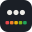
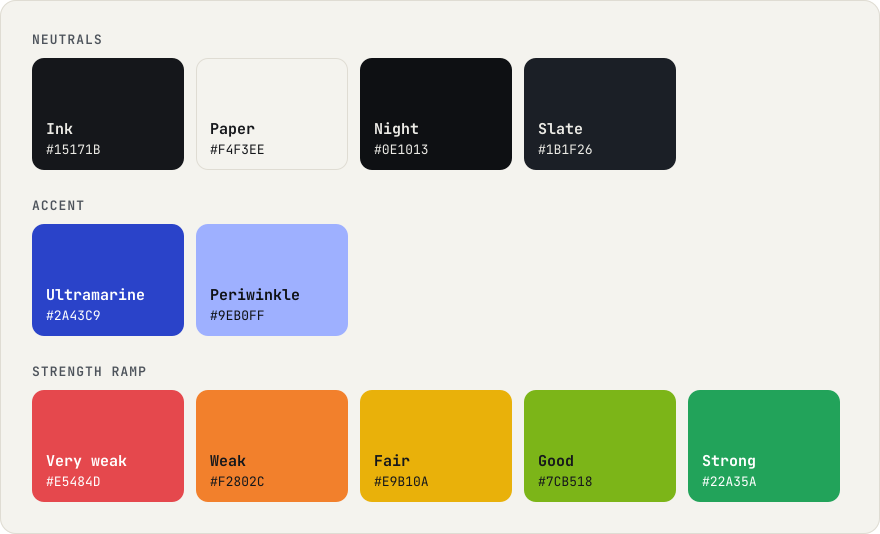

<picture>
  <source media="(prefers-color-scheme: dark)" srcset="logo/lockup-on-dark.svg">
  
</picture>

# Brand

Passcore looks like what it does: a masked password over a strength meter. The identity is the one the [playground](https://elboletaire.github.io/password-strength-meter/) already uses: ink on warm paper (or paper on ink), one ultramarine accent and the meter's five-level ramp as the signature. Everything in this folder is free to use under the project's [MIT licence](../LICENSE) when you write or talk about Passcore.

## Name

- **Passcore** in prose, with a capital P. The wordmark is always lowercase: **passcore**.
- It plays on *pass score* and on *core*, the small core every package shares. Never *PassCore*, *Pass Core* or *passscore*.
- Packages are `@passcore/<name>`, set in code.

## Logo

| Mark | Inverse | Slate | One colour |
|:-:|:-:|:-:|:-:|
|  |  |  |  |
| Default, on light backgrounds | On dark or busy backgrounds | On Night, as the playground's dark theme | Print, stamps, single-ink uses |

The mark is three masked characters over the five levels of the meter, drawn on a 32-unit grid: an 8-unit corner radius, dots of radius 2.6 and bars of 3.6 × 3.4. Keep a clear space of a quarter of the mark's width around it and don't use it smaller than 16 px.

The lockup puts the mark next to the wordmark, which is centred on its x-height. Use [`lockup-on-light.svg`](logo/lockup-on-light.svg) or [`lockup-on-dark.svg`](logo/lockup-on-dark.svg), and the [`wordmark-*`](logo) files alone when the mark is already nearby.

Don't recolour or reorder the bars (they always run from very weak to strong, left to right), add effects to the mark, or set the wordmark in another typeface.

## Colour

<picture>
  <source media="(prefers-color-scheme: dark)" srcset="palette-dark.svg">
  
</picture>

- **Neutrals** carry everything: Ink on Paper in light, Paper (`#ECEBE6`) on Night in dark, Slate for raised surfaces.
- **Ultramarine** is the only accent, for links and actions. On dark backgrounds use **Periwinkle**.
- **The strength ramp** is the signature: the logo's bars, the hairline across the top of the site and of every banner. It means strength, so don't use its colours for anything else. The meters' UI uses theme-adjusted pairs of these colours, defined in the playground's [`style.css`](../apps/playground/src/style.css).

## Type

- **JetBrains Mono** (OFL, [self-hosted in the playground](../apps/playground/src/fonts)) for the wordmark, headings, numbers, labels and passwords. The wordmark is weight 750 with −0.03em tracking.
- **The system sans-serif** for prose.
- Bullets, the dots of a masked password, are the background texture.

## Voice

Plain and specific. Say what a password needs, not that it is "bad". Short sentences, no exclamation marks, no fear: Passcore helps people pick a better password, it doesn't scold them.

## Files

| File | Use |
|---|---|
| [`banner-light.svg`](banner-light.svg), [`banner-dark.svg`](banner-dark.svg) | README header, 1280 × 360 |
| [`social/`](social), [`png/social-preview-*.png`](png) | GitHub social preview and Open Graph, 1280 × 640 |
| [`levels-light.svg`](levels-light.svg), [`levels-dark.svg`](levels-dark.svg) | The five levels as the meter shows them |
| [`favicon.svg`](favicon.svg), [`favicon.ico`](favicon.ico), [`png/mark-*.png`](png) | Favicons and app icons (16 to 1024 px) |

The SVGs have their text converted to outlines, so they render the same without the font installed.
